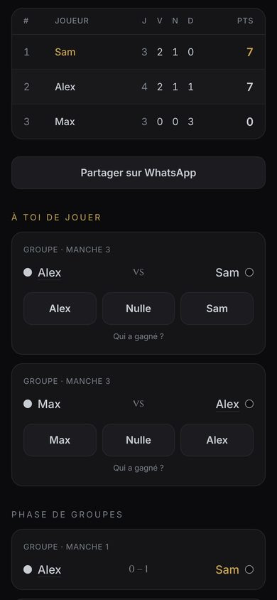
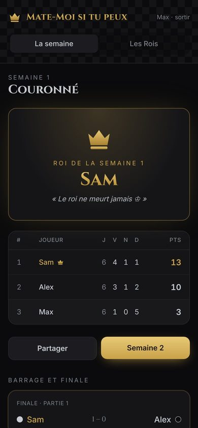
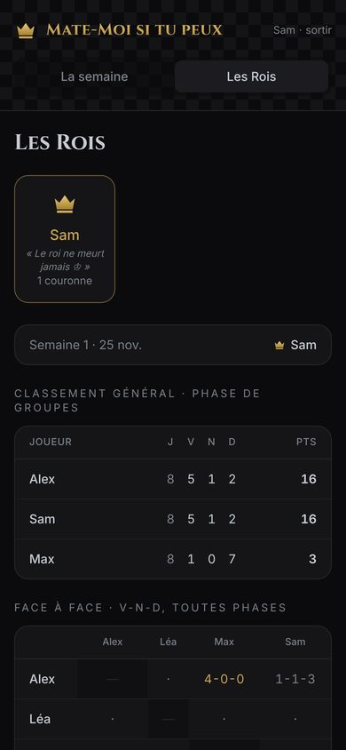

<div align="center">


# Mate-Moi si tu peux

**A weekly chess league for friends. Everyone plays everyone, the top two play the final, one King of the Week.**

[](https://github.com/Armandcaft/mate-moi/actions/workflows/ci.yml)
[](https://mate-moi.fly.dev)






</div>

## ♟️ How a week goes

1. **Someone starts the week.** The app schedules every pairing and picks colours.
2. **Play anywhere** (a real board, Lichess, the office). Then one player taps the winner, or *Draw*.
3. **The opponent confirms** or disputes. Only confirmed results count; one left unanswered for
   48 h counts as reported.
4. **The top two play the final.** A drawn final goes to Armageddon.
5. **♔ The King is crowned,** their motto shows up, and the standings go to WhatsApp as an image.

## ✨ Features

| | |
|---|---|
| 🏆 **Standings & tie-breaks** | 3 / 1 / 0 points, then head-to-head, wins, and Armageddon play-offs |
| 📈 **Scales with the group** | 3 games per opponent up to 4 players, 2 up to 6, then 1 |
| 📣 **Nudge** | one tap sends the group what the week is waiting for: games to play per pair, results to confirm (and by whom), the deadline |
| 📲 **WhatsApp previews** | the share link unfurls into a standings card, King and motto included |
| ✉️ **Invite links** | one-time, 48 h; newcomers pick their own name and code, and can join mid-week |
| 🙋 **Profiles** | change your name, your motto (60 characters), your code; delete your account (your games stay, as “Deleted player”) |
| 📅 **Week deadline** | the group stage closes after 7 days (admins can move it); unplayed games end 0 – 0, lost by both, and the final goes ahead |
| ⏱️ **Auto-confirm** | a result nobody confirms or disputes for 48 h counts; the card counts the hours down |
| 🚪 **Leaving mid-week** | an archived or deleted player's group games are dropped, or their play-off and final games forfeited, so the week still crowns a King |
| 📊 **Stats** | in the Hall of Kings: current and best streaks, win rate, games played, your *bête noire* and your favourite victim |
| 🛡️ **Admin tab** | invites, temporary codes, archiving, deletion, promotion, one-click backup |
| 👑 **One owner** | set from the command line; nobody can demote, archive or delete them; they hand the league on from the Admin tab |
| 🌍 **Three languages** | French (default), English, German; follows the phone, switchable anytime |
| 🌗 **Light & dark** | black-and-gold or ivory board; follows the phone, or pick one on your profile |
| 🔐 **Locked down** | peppered scrypt codes, lockout after 5 tries; only login, invitations and link previews are public |

<details>
<summary><b>📜 The exact rules</b></summary>

- **Group stage**: every pair plays 3, 2 or 1 games depending on the group size when the week
  starts. Colours alternate; who gets the extra White flips every week. Win 3, draw 1, loss 0.
- **Ties** on points, in order: points between the tied players, number of wins, then an
  Armageddon play-off (a draw counts as a win for Black), repeated until someone is ahead.
  Only the tie that decides a place in the final is played off.
- **Final**: the better-ranked player has White. A draw sends it to Armageddon, where the
  better-ranked player has Black, and with it the draw odds.
- **Deadline**: the group stage ends seven days after the week starts (admins can move it). Then
  pending results count as reported, and games nobody played end **0 – 0**: a loss for both, no
  points. The play-off and the final have no deadline.
- **Joining mid-week**: during the group stage, the newcomer's games against everyone are added
  (as many as each pair plays that week), so the round-robin stays even and the final waits for
  them. During a play-off or the final, they start the next week.

The rules are pure, tested functions in [`src/lib/tournament/`](src/lib/tournament).
</details>

## 🧰 Commands

### On your computer

| Command | What it does |
|---|---|
| `npm install` | install dependencies |
| `npm run dev` | dev server on http://localhost:5173 |
| `npm test` | unit tests (rules, codes, profiles, translations) |
| `npm run check` · `check:watch` | type-check Svelte and TypeScript |
| `npm run build` then `npm start` | production build, served on port 3000 |
| `npm run preview` | preview the production build |
| `npm run db:generate` | write a migration after editing `src/lib/server/db/schema.ts` (commit `drizzle/`) |

### Players (the `player` script)

Locally: `npm run player -- <command>`. On Fly.io:
`fly ssh console -C "sh -c 'cd /app && node scripts/player.ts <command>'"`.

| Command | What it does |
|---|---|
| `add <name> <code>` | new player with a **temporary** code (6 to 8 digits); they choose their own at first login |
| `pin <name> <code>` | forgotten code: a new temporary one, also lifts a lockout |
| `promote <name>` · `demote <name>` | give or remove the admin tab |
| `owner <name>` | make them the league's **owner** (and an admin), replacing the previous one; the owner can't be demoted, archived or deleted, here or in the app |
| `deactivate <name>` · `activate <name>` | archive (sign out, bench, history kept) or restore a player; refused while they play the current week (use the Admin tab) |
| `delete <name>` | delete an account: name, code and motto gone, games kept as “Deleted player” (none: the row goes too); same refusal |
| `list` | everyone, with admin and archived flags |

After the first admin exists, the **Admin tab** does all of this from the app.

### On Fly.io

| Command | What it does |
|---|---|
| `fly deploy` | deploy (or let the GitHub integration deploy on push) |
| `fly status` · `fly logs` | is it up, what is it saying |
| `fly scale count 1` | keep **one** machine: SQLite lives on one volume |
| `fly machine start` · `fly machine restart` | wake it up, or restart (also applies a restore) |
| `fly secrets set PIN_PEPPER=$(openssl rand -hex 32)` | once, **before** creating players; never change it |
| `fly volumes list` · `fly volumes snapshots list <id>` | the disk, and Fly's daily snapshots (5 days) |
| `fly ssh sftp shell` → `put backup.db /data/restore.db` | upload a backup to restore it at the next start |

<details>
<summary><b>🚀 First deployment</b></summary>

```sh
fly launch --no-deploy --copy-config        # keeps fly.toml; change "app" (and ORIGIN) if taken
fly volumes create mate_moi_data --size 1 --region cdg
fly secrets set PIN_PEPPER=$(openssl rand -hex 32)
fly deploy
fly ssh console -C "sh -c 'cd /app && node scripts/player.ts add Frank 482915'"
fly ssh console -C "sh -c 'cd /app && node scripts/player.ts owner Frank'"
```
</details>

<details>
<summary><b>💾 Backup, restore, moving to another server</b></summary>

The whole league is **one SQLite file**. *Admin → Download the whole league* gives a consistent
copy taken while the app runs.

**Restore**: put the file next to the database as `restore.db` and restart. The app swaps it in at
start-up and keeps the replaced one as `mate-moi.db.before-restore-<date>`.

```sh
fly ssh sftp shell        # then: put mate-moi-2026-11-25.db /data/restore.db
fly machine restart

# a VPS with Docker, volume mounted on /data
cp mate-moi-2026-11-25.db /path/to/volume/restore.db && docker restart mate-moi
```

**Moving servers**: restore the backup there and **reuse the same `PIN_PEPPER`**, or no code will
work (then give everyone a temporary one with `player pin`). The backup holds the hashed codes:
keep it private.

**Continuous backups** with [Litestream](https://litestream.io) to any S3-compatible storage
(R2, B2, Tigris…); a fresh volume restores itself:

```sh
fly secrets set LITESTREAM_REPLICA_URL=s3://my-bucket/mate-moi \
  LITESTREAM_ACCESS_KEY_ID=… LITESTREAM_SECRET_ACCESS_KEY=…
```
For R2 or B2, also add `endpoint:` in `litestream.yml`.
</details>

## 🗂️ Inside

```
src/lib/tournament/   the rules: schedule, standings, tie-breaks, what the week needs next
src/lib/server/       database, auth & codes, league writes, admin, profiles, preview image
src/lib/i18n/         fr / en / de dictionaries
src/routes/           week · rois · profil · code · admin · invitation · partage · og · login
scripts/player.ts     the player command line
drizzle/              migrations, applied at start-up
```

CI runs the type check, the tests, the build, and builds the Docker image and checks that it
serves `/health` and a preview image. Contributor notes: [`CLAUDE.md`](CLAUDE.md).

<div align="center"><sub>Made for a WhatsApp group of friends · ♔ Mate-moi si tu peux</sub></div>
